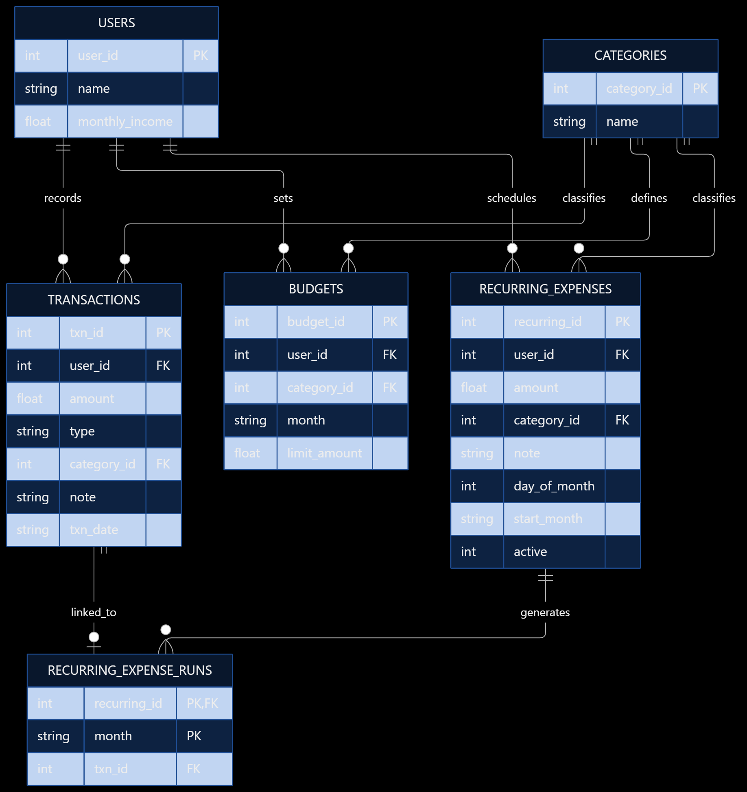

# PaisaPal – AI Personal Expense & Budget Coach

**Team:** T3  
**Hackathon:** INCRED Applications Pvt. Ltd. AI Agent Hackathon  
**Project:** Personal Expense & Budget Coach  
**Technology:** JavaScript, Node.js, LangChain, Groq LLM, SQLite, Zod

## 1. Project Overview

PaisaPal is an AI-powered personal finance assistant that helps users manage daily expenses, track transactions, set monthly budgets, and understand their spending habits through natural language.

Instead of manually entering financial records, users can simply chat with PaisaPal.

For example:

- "I spent ₹250 on pizza yesterday."
- "How much did I spend on food this month?"
- "Set my shopping budget to ₹3,000."
- "Am I over budget anywhere?"
- "Compare this month's spending with last month."
- "Add my ₹8,000 rent automatically every month."

PaisaPal understands the user's request, selects the appropriate tool, interacts with the SQLite database, and returns a clear response.

## 2. Problem Statement

Managing personal expenses manually can be difficult and time-consuming. People often forget to record transactions, exceed budgets, or fail to understand their spending patterns.

PaisaPal solves these problems by providing a conversational AI agent that can:

- Record income and expenses.
- Retrieve and filter transactions.
- Calculate monthly spending.
- Set and monitor budgets.
- Alert users about overspending.
- Delete transactions safely.
- Handle multiple expenses in one message.
- Manage recurring monthly expenses.

## 3. Technology Stack

| Technology | Purpose |
|---|---|
| JavaScript | Application programming language |
| Node.js | Backend runtime and terminal application |
| LangChain | AI agent creation and tool calling |
| Groq API | LLM inference |
| GPT-OSS 120B | Language model used by the agent |
| SQLite | Persistent storage for financial data |
| Zod | Tool input validation |
| LangGraph MemorySaver | Short-term conversation memory |
| dotenv | Environment variable management |

## 4. Project Structure

```text
PaisaPal/
│
├── paisapal.js
├── tools.js
├── package.json
├── package-lock.json
├── .env.example
├── .gitignore
├── README.md
├── test_prompts.md
│
├── database/
│   ├── db.js
│   ├── schema.sql
│   ├── setup.js
│   └── seed.js
│
└── data/
    └── [SQLite database file]
```

**paisapal.js:** Contains the Groq model configuration, LangChain agent, system prompt, conversation memory, and command-line chat interface.

**tools.js:** Contains the financial tools, input validation, SQL operations, budget calculations, and transaction confirmation logic.

**database/db.js:** Manages the SQLite database connection.

**database/schema.sql:** Defines the database tables.

**database/setup.js:** Initializes the database.

**database/seed.js:** Adds sample users, transactions, categories, and budgets.

## 5. Database Design

PaisaPal uses SQLite to store financial information.

### Users

Stores user information.

| Column | Description |
|---|---|
| user_id | Unique user identifier |
| name | User's name |
| monthly_income | Monthly income |

### Categories

Stores expense categories such as Food, Travel, Rent, Shopping, Bills, Entertainment, and Other.

| Column | Description |
|---|---|
| category_id | Unique category identifier |
| name | Category name |

### Transactions

Stores income and expense records.

| Column | Description |
|---|---|
| txn_id | Unique transaction identifier |
| user_id | Transaction owner |
| amount | Transaction amount |
| type | INCOME or EXPENSE |
| category_id | Category identifier |
| note | Transaction description |
| txn_date | Transaction date |

### Budgets

Stores monthly category budgets.

| Column | Description |
|---|---|
| budget_id | Unique budget identifier |
| user_id | Budget owner |
| category_id | Expense category |
| month | Budget month in YYYY-MM format |
| limit_amount | Monthly budget limit |

### Recurring Expenses (Bonus)

The bonus feature adds recurring expense schedules and records which monthly payments have already been posted.

**recurring_expenses:** Stores the user, amount, category, note, monthly payment day, starting month, and active status.

**recurring_expense_runs:** Records the month and transaction ID for each generated recurring payment to prevent duplicate posting.

### Database Relationships

```text
users
  ├── transactions
  ├── budgets
  └── recurring_expenses

categories
  ├── transactions
  ├── budgets
  └── recurring_expenses

recurring_expenses
  └── recurring_expense_runs
        └── transactions
```

The seeded database contains three users, seven categories, more than 60 sample transactions across two months, and monthly category budgets.

## 6. Core AI Agent Tools

PaisaPal implements the six required financial tools.

### Tool 1: add_transaction

Adds a new income or expense after user confirmation.

Example:

**User:** I spent ₹250 on pizza yesterday.

**PaisaPal:** Prepare a ₹250 Food expense for yesterday and ask for confirmation.

### Tool 2: list_transactions

Retrieves transactions from SQLite.

Supports filtering by category, transaction type, and date range.

Example:

**User:** Show my Food transactions this month.

### Tool 3: get_spending_summary

Calculates actual monthly spending using SQL aggregation.

Provides category totals and spending percentages.

Example:

**User:** How much did I spend on Food this month?

### Tool 4: set_budget

Creates or updates a monthly budget after confirmation.

Example:

**User:** Set my Shopping budget to ₹3,000 this month.

### Tool 5: check_budget_status

Compares category spending against monthly budget limits.

Budget rules:

- **SAFE:** Spending is at or below 80% of the budget.
- **WARNING:** Spending is above 80% but not above 100%.
- **OVER_BUDGET:** Spending exceeds 100%.

### Tool 6: delete_transaction

Deletes a transaction by its ID after explicit confirmation.

Example:

**User:** Delete transaction 25.

The agent displays transaction details before asking for confirmation.

## 7. Additional Feature: Multiple Transactions

PaisaPal supports multiple expenses in a single natural-language message.

Example:

**User:** Spent ₹250 on pizza yesterday and ₹120 on an auto today.

The agent identifies:

1. ₹250 — Food — Pizza — Yesterday.
2. ₹120 — Travel — Auto — Today.

The user confirms both transactions together.

SQLite transactions are used so the batch is committed together, preventing partial saving if an insert fails.

## 8. Bonus Feature: Automatic Recurring Expenses

PaisaPal supports recurring monthly expenses such as rent, streaming subscriptions, and other regular payments.

### Features

- Create monthly expense schedules using natural language.
- Select the expense amount, category, description, and payment day.
- Store schedules permanently in SQLite.
- Automatically create transactions when payments become due.
- Prevent duplicate monthly entries.
- List existing recurring expenses.
- Cancel recurring schedules after confirmation.
- Check budget warnings after automatic expense posting.

### Example

**User:** Add a recurring Netflix subscription of ₹299 on the 5th of every month under Entertainment.

PaisaPal prepares the schedule and requests confirmation.

Once confirmed, the schedule is stored in SQLite.

### How Automatic Posting Works

When PaisaPal starts or processes chat activity, it checks whether recurring expenses are due.

If a payment is due and has not already been recorded for the month, the application creates the corresponding expense transaction.

If PaisaPal is not running on the due date, the transaction is added when the application next runs and checks the schedule.

For months shorter than the configured payment day, the application uses the last day of that month.

**Note:** This is application-triggered automation, not a continuously running background scheduler.

## 9. AI Agent Architecture

```text
User
  |
  v
Terminal Chat Interface
  |
  v
LangChain AI Agent
  |
  +---- Groq Language Model
  |
  +---- Conversation Memory
  |
  +---- Financial Tools
             |
             v
        SQLite Database
             |
             v
       Tool Result
             |
             v
       PaisaPal Response
```

The language model understands the request and chooses a tool.

Tools perform the actual database operations.

Financial totals are calculated from SQLite records rather than generated by the language model.

## 10. Business Rules and Safety

PaisaPal implements several safeguards:

- Transaction amounts must be positive.
- Dates are validated before insertion.
- Natural-language dates are converted to YYYY-MM-DD.
- Unknown categories are rejected.
- Missing required information should be requested from the user.
- Database queries use parameterized SQL.
- Transaction and budget modifications require confirmation.
- Deletions require explicit confirmation.
- Queries are scoped to the current user.
- Budget warnings are calculated from saved records.
- Multiple expense inserts use SQLite transaction handling.
- The language model does not directly execute arbitrary SQL.

The current command-line demonstration uses Rahul (user ID 1).

## 11. Installation and Setup

### Prerequisites

- Node.js with support for `node:sqlite`
- npm
- Groq API key
- Visual Studio Code or another code editor

### Step 1: Clone or download the project

```bash
git clone YOUR_REPOSITORY_URL
cd PaisaPal
```

Alternatively, extract the project ZIP and open the folder in VS Code.

### Step 2: Install dependencies

```bash
npm install
```

### Step 3: Configure the API key

Create a `.env` file in the project root.

```env
GROQ_API_KEY=your_groq_api_key_here
```

Do not commit your real `.env` file or API key to GitHub.

### Step 4: Initialize the database

For a fresh installation:

```bash
node database/setup.js
node database/seed.js
```

Do not reseed an existing database containing important transactions.

### Step 5: Run PaisaPal

```bash
node paisapal.js
```

If Node.js displays an experimental SQLite warning, it may be suppressed using:

```bash
node --disable-warning=ExperimentalWarning paisapal.js
```

## 12. Example Prompts

### Record expenses

```text
Spent 250 on pizza yesterday and 120 on an auto today.
```

### Spending summary

```text
How much did I spend on food this month?
```

### Set a budget

```text
Set my shopping budget to 3000 for this month.
```

### Check budgets

```text
Am I over budget anywhere?
```

### Spending comparison

```text
Compare my spending this month with last month
and give me 3 saving tips.
```

### Recurring expense

```text
Create a recurring rent expense of 8000 rupees
on the 1st of every month in Rent.
```

### View recurring expenses

```text
Show my recurring expenses.
```

### Cancel a recurring expense

```text
Stop recurring expense number 1.
```

## 13. Testing

The project includes `test_prompts.md` for documenting the mandatory judge prompts and actual agent responses.

The testing checklist covers:

- Transaction insertion.
- Multiple transaction insertion.
- Monthly spending summaries.
- Budget creation and updates.
- Budget warnings and over-budget alerts.
- Transaction listing and filtering.
- Transaction deletion confirmation.
- Invalid amounts and categories.
- Recurring expense creation and cancellation.
- Duplicate recurring payment prevention.

## 14. Future Improvements

Possible future enhancements include:

- Web-based dashboard.
- Interactive spending charts.
- Multi-user authentication.
- Scheduled background jobs for recurring expenses.
- Exporting reports to CSV and PDF.
- Email and mobile budget notifications.
- Advanced financial insights and saving recommendations.

## 15. Conclusion

PaisaPal combines conversational AI, structured tool calling, and a persistent SQLite database to simplify personal expense management.

The application helps users record expenses, understand spending patterns, manage budgets, and automate recurring financial entries.

Its modular structure separates AI agent logic from financial tools, making the project easier to maintain and extend.

# ER Diagram
